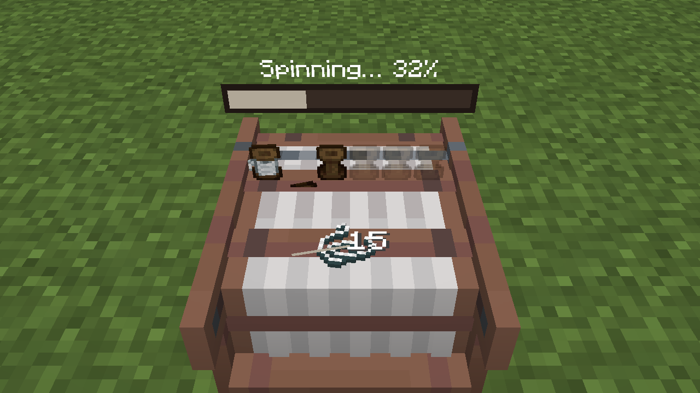
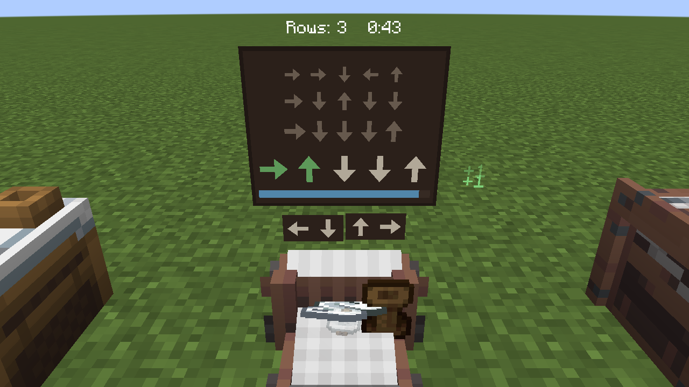
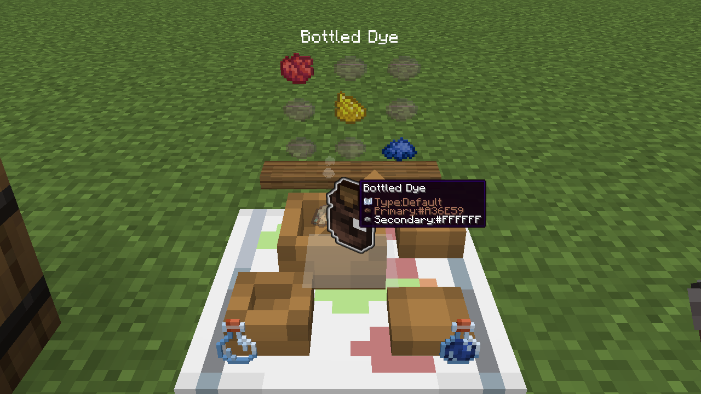
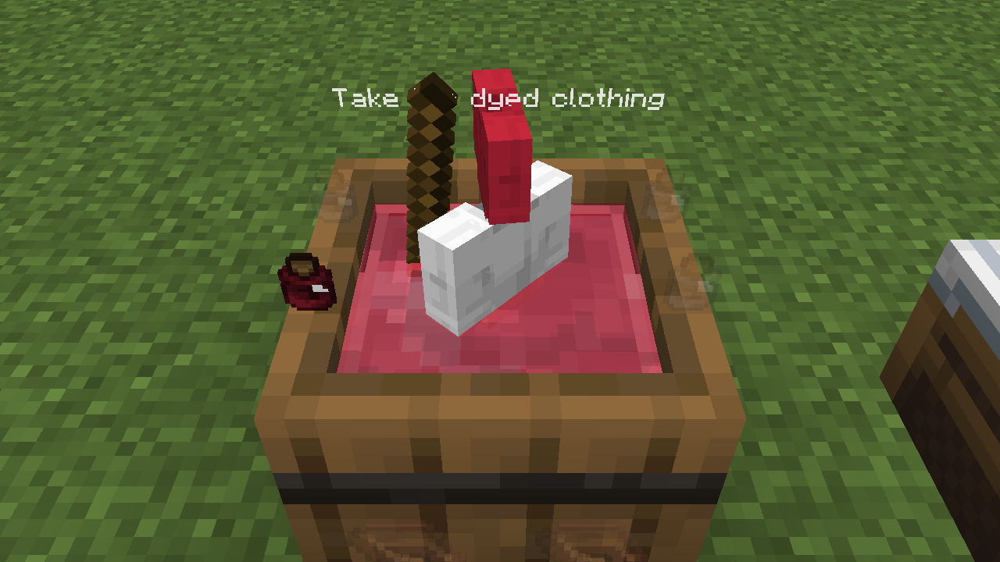

# Hands-On Weavers Paradise

An addon for [Weavers Paradise](https://modrinth.com/mod/weavers-paradise) on **NeoForge 1.21.1**, built on the
[Diegesis](https://modrinth.com/mod/diegesis-api) library, in the spirit of
[Hands-On Delight](https://github.com/Pocky-l/handson-delight): the stations of Weavers Paradise open **right in the
world**, with no menu screen.

| Spinning jenny | Clothcrafting station | Dyemaking table | Dyeing barrel |
|---|---|---|---|
|  |  |  |  |

- **Spinning jenny.** The fibre lies on the jenny, the six spools stand in a row behind it. While it spins, the spool being
  wound turns, a thread runs to it from the fibre, lint drifts off, and a strip over the jenny fills with the spool.
- **Clothcrafting station.** Lay the spools on the loom and click the shuttle. A board rises over the loom with the row of
  arrows to type and the rows to come, and a strip under it runs down with the clock. Type the row with the arrow keys,
  WASD, Weavers Paradise's own minigame keys or the four pedals under the board: each row typed right throws the shuttle
  across and the cloth on the loom grows. When the clock runs out, the cloth hovers beside the loom with the quality the
  rows earned, as Weavers Paradise reckons it.
- **Dyemaking table.** The dyes stand in a rack of three by three behind the table, the empty bottle and the water at its
  front corners, the dye core in the pot. When they make a dye the pot steams and the bottled dye hovers over the table;
  taking it uses up the ingredients as the mod's own screen does.
- **Nothing replaced.** The items stay in the blocks' own inventories; the blocks keep working by themselves (the jenny
  spins, the clock of a weaving runs, hoppers reach them). Sneaking + use keeps the mod's own screens. The mod adds no
  blocks or items.

- **Dyeing barrel**, worked as the cooking pot of Hands-On Delight. Drop the clothing into the bath and it floats there;
  stand bottled dye on the rim (the left for the front side, the right for the back of double-sided clothing) and the bath
  takes its colour; hang the stencils on the barrel's front. What the dye will make hovers over the barrel, see-through and
  out of reach. Take the paddle by its handle and stir: the dye swirls round after it, the preview grows firmer, and after
  a few rounds the dye takes: the clothing in the bath is dyed (a dose of each dye used, as the mod's screen uses it) and
  is taken out of the bath.

## Requirements

| | Version |
|---|---|
| Minecraft | 1.21.1 |
| NeoForge | 21.1.253 or newer |
| Weavers Paradise | 1.6.4 or newer (NeoForge), with its VortyLib and Curios |
| Diegesis | 1.0.0-beta.14 or newer |

Install on the client and on the server.

## Building

```bash
./gradlew build
```

The jar is in `build/libs/`. `./gradlew runShots` (dev only) builds a test world, works every station and saves
screenshots to `shots/`; it runs headless under `xvfb-run` too.

## How it works

- `station/WeaverStations` declares the four Diegesis stations, their slot groups bound to the blocks' own slots.
- `station/LoomLogic` starts a weaving as the mod's start button does and counts each row, checked against the row the
  weaving's seed makes (`station/WeavingRows`); the block's own clock then weaves the cloth from the points.
- `client/*Behavior` draw the boards, bars, threads and pedals, and take the arrow keys while weaving.
- `assets/handson_weavers_paradise/diegesis/scenes/` holds the scenes: cameras, slots and nodes.

## License

MIT
